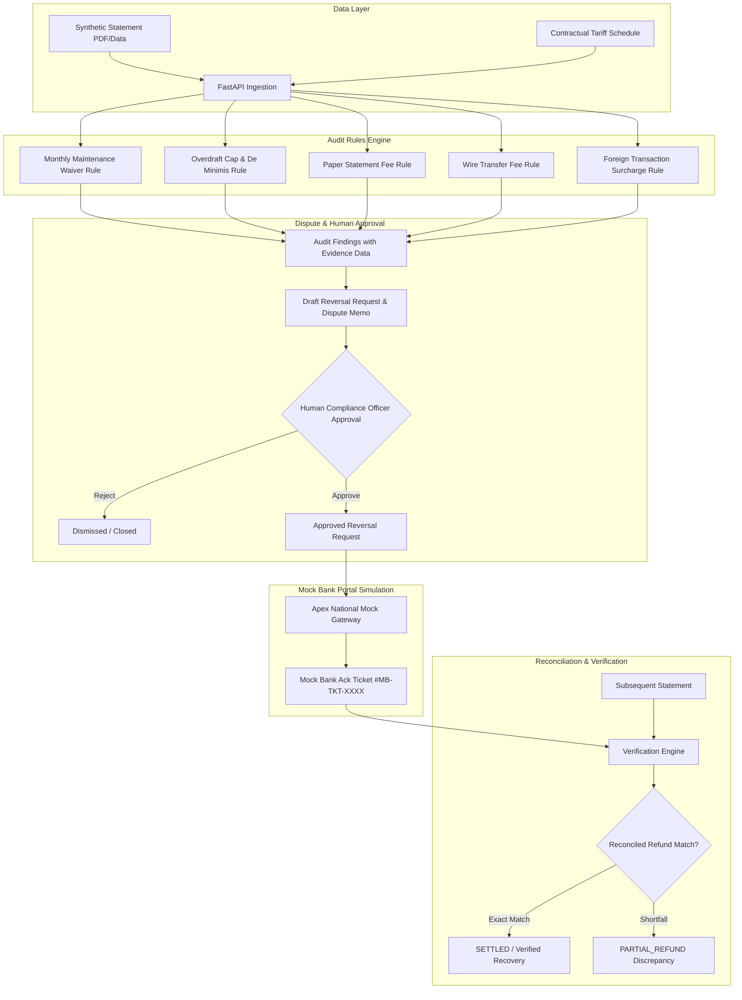

# 🛡️ Bank Fee Auditor

**Bank Fee Auditor** is an enterprise-grade full-stack web application built for the **Ziro Hackathon**. It continuously audits bank statements against contractual tariff schedules, identifies potentially non-compliant and erroneous fees, produces legally defensible structured evidence, drafts formal dispute letters, enforces **human-in-the-loop approval gating**, submits reversals to an isolated **Mock Bank Portal**, and reconciles refunds against subsequent statements.

---

## 🏛️ System Architecture



---

## 🚀 Tech Stack

- **Frontend:** React 18, TypeScript, Vite, Tailwind CSS, Lucide React icons.
- **Backend:** Python 3.12, FastAPI, Pydantic v2, Pydantic Settings.
- **Database ORM & Migrations:** SQLAlchemy 2.0 (asyncio) and Alembic migrations.
- **Database Engines:** PostgreSQL (Production / Render) with full fallback support for SQLite (`sqlite+aiosqlite`) for zero-friction local development.
- **Testing:** `pytest` & `pytest-asyncio` for backend test suites; `vitest` & React Testing Library for frontend.
- **Deployment:** Render (`render.yaml` included), where FastAPI serves both REST API routes and the built React static assets.

---

## 🔑 Core Features & Architectural Standards

1. **Stable UUIDs & Provenance Tracking:**
   Every account, statement, transaction, audit finding, and reversal carries a stable UUID (`UUIDv4`). Statements record raw cryptographic SHA-256 hashes (`raw_statement_hash`) to guarantee synthetic evidence integrity.

2. **Audit Rules Engine:**
   - **Monthly Maintenance Fee Waiver:** Audits whether fees were assessed when the account met average daily balance (ADB) or qualifying direct deposit thresholds.
   - **Overdraft & NSF Limits:** Audits statutory/contractual daily frequency caps (e.g. maximum 3 per day) and de minimis transaction thresholds ($5.00 grace limit).
   - **Paper Statement Enrollment:** Flags paper statement delivery fees charged on accounts actively enrolled in paperless e-statements.
   - **Wire Transfer Schedule:** Enforces tier benefits (e.g., complimentary incoming domestic wires for Premier tiers) and flags overcharged wire fees.
   - **Foreign Transaction Surcharges:** Identifies FX fees assessed on domestic or USD-settled transactions.

3. **Human-in-the-Loop Approval Gating:**
   Under strict policy, **no reversal request can be submitted to the bank without explicit human review and sign-off**. The system enforces this gate at both the service layer and database schema level.

4. **Isolated Mock Bank Gateway:**
   All actions target an isolated mock bank portal (`Apex National Mock Gateway`). **No live banking credentials, real banking APIs, or real monetary transfers exist.**

5. **Subsequent Statement Reconciliation:**
   Once a reversal is submitted and acknowledged with a mock bank ticket, the verification engine analyzes the subsequent month's statement for matching credit transactions.

---

## 🗄️ Database Models (11 Tables)

| Model | Table | Description |
|---|---|---|
| `AccountTier` | `account_tiers` | Defines banking tiers, maintenance fees, balance waivers, overdraft policies. |
| `Account` | `accounts` | Customer account, masked account numbers, routing number, electronic enrollment. |
| `TariffRule` | `tariff_rules` | Granular fee rules with JSON condition logic, effective dates, document references. |
| `Statement` | `statements` | Monthly billing period, opening/closing balance, ADB, SHA-256 hash. |
| `Transaction` | `transactions` | Line-item debits, credits, fee charges, and balances. |
| `AuditFinding` | `audit_findings` | Fee violation details, mathematical proof, structured evidence snapshot. |
| `ReversalRequest` | `reversal_requests` | Formal dispute memo, requested refund amount, review status. |
| `ApprovalEvent` | `approval_events` | Immutable audit trail of human approver, action (APPROVE/REJECT), notes, IP address. |
| `MockBankAck` | `mock_bank_acks` | Mock ticket ID, status received (`ACCEPTED`), acknowledgement payload. |
| `VerificationResult` | `verification_results` | Match outcome (`MATCHED_EXACT`, `PARTIAL_REFUND`, `NOT_FOUND`), refund reconciliation. |
| `TestRun` | `test_runs` | Automated audit scenario benchmark runs, duration ms, recovery metrics. |

---

## ⚙️ Environment Variables

Copy `.env.example` to `.env`:

```bash
cp .env.example .env
```

| Variable | Default (Local) | Production (Render) | Description |
|---|---|---|---|
| `APP_NAME` | `Bank Fee Auditor` | `Bank Fee Auditor` | Application title |
| `APP_ENV` | `development` | `production` | Environment mode |
| `DEBUG` | `true` | `false` | Debug logging toggle |
| `DATABASE_URL` | `sqlite+aiosqlite:///./bank_fee_auditor.db` | `postgresql+asyncpg://...` | Async database URL |
| `SYNC_DATABASE_URL` | `sqlite:///./bank_fee_auditor.db` | `postgresql://...` | Sync URL for Alembic migrations |
| `MOCK_BANK_PORTAL_NAME` | `Apex National Mock Gateway` | `Apex National Mock Gateway` | Mock portal gateway name |
| `MOCK_BANK_AUTO_ACK` | `true` | `true` | Automatic mock ticket generation |

---

## 🏃 Quick Start: Local Development

### 1. Prerequisites
- Python 3.11+
- Node.js 18+ & npm

### 2. Backend Setup
```bash
# Navigate to project root
cd "Bank Fee Auditor"

# Create and activate virtual environment
python -m venv backend/venv
# Windows PowerShell:
.\backend\venv\Scripts\Activate.ps1
# macOS / Linux:
# source backend/venv/bin/activate

# Install backend dependencies
pip install -r backend/requirements.txt

# Run database migrations (or auto-initialized on startup)
alembic upgrade head

# Start FastAPI server (serves API on http://127.0.0.1:8000)
uvicorn backend.app.main:app --reload --port 8000
```

### 3. Frontend Setup
In a separate terminal:
```bash
cd frontend
npm install
npm run dev
```
Open **http://localhost:5173** to view the banking dashboard.

---

## 🧪 Testing

### Backend Unit & Integration Tests (13 Tests)
```bash
# Run full pytest test suite
pytest backend/tests -v
```

Tests cover:
- Rule unit evaluations (Monthly maintenance waiver, Overdraft daily caps & thresholds, Paper fees, Wire benefit).
- Audit statement workflow & idempotency.
- Gating enforcement: Submissions without prior human approval strictly raise `ValueError`.
- Mock bank gateway ticket acknowledgment.
- Subsequent statement refund reconciliation.
- REST API endpoint contracts.

### Frontend Component Tests
```bash
cd frontend
npm test
```

---

## 🌐 Production Deployment (Render)

The project includes a ready-to-deploy `render.yaml` blueprint:

```yaml
services:
  - type: web
    name: bank-fee-auditor
    env: python
    buildCommand: |
      pip install -r backend/requirements.txt
      cd frontend && npm install && npm run build && cd ..
    startCommand: uvicorn backend.app.main:app --host 0.0.0.0 --port $PORT
```

When deployed to Render:
1. `npm run build` compiles the frontend into `frontend/dist`.
2. FastAPI automatically mounts and serves `frontend/dist` static assets and handles SPA routing for any non-API request.
3. PostgreSQL is attached automatically via `DATABASE_URL`.

---

## 🛡️ Synthetic Safety Guarantee
**No real bank credentials, customer PII, or real financial transactions are used or permitted.** All data is synthetic, deterministic, and self-contained. Reversal submissions interact solely with the internal `Apex National Mock Gateway`.
